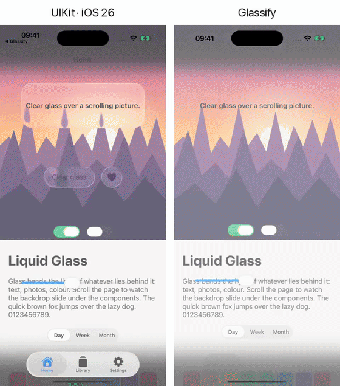

<h1 align="center">Glassify</h1>

<p align="center">
  The Liquid Glass look of iOS 26, for apps that support iOS 13 and later.
</p>

<p align="center">
  
  
  
  
  
</p>

<p align="center">
  
</p>

<p align="center">
  The same app twice: UIKit on iOS 26 on the left, Glassify on the right.
</p>

Glassify draws the glass with Metal, so it looks the same on every iOS version, including iOS 26.

## Features

- [x] Glass views: regular, clear, tinted and interactive
- [x] Glass containers that merge nearby shapes into one
- [x] Glass buttons in four styles and three sizes
- [x] Switch, slider and segmented control with the liquid glass knob
- [x] Navigation controller with a glass navigation bar and toolbar
- [x] Tab bar controller with the floating glass tab bar and its liquid lens
- [x] Light and dark mode
- [x] Swift and Objective-C
- [x] Swift Package Manager, CocoaPods and Bazel

## Requirements

- iOS 13.0+
- Xcode 15.0+

## Installation

### Swift Package Manager

In Xcode, choose **File > Add Package Dependencies** and enter:

```
https://github.com/dotdot911/Glassify.git
```

Or add it to `Package.swift`:

```swift
dependencies: [
    .package(url: "https://github.com/dotdot911/Glassify.git", from: "0.1.0")
]
```

### CocoaPods

```ruby
pod 'Glassify', '~> 0.1'
```

### Bazel

In `MODULE.bazel`:

```python
bazel_dep(name = "glassify", version = "0.1.0")
git_override(
    module_name = "glassify",
    remote = "https://github.com/dotdot911/Glassify.git",
    tag = "0.1.0",
)
```

Then add `@glassify//:Glassify` to the `deps` of your target.

## Usage

### Glass view

```swift
import Glassify

let glass = GLSGlassView(frame: CGRect(x: 20, y: 100, width: 200, height: 56))
view.addSubview(glass)

let label = UILabel(frame: glass.contentView.bounds)
label.text = "Hello"
label.textAlignment = .center
glass.contentView.addSubview(label)
```

Put labels and icons in `contentView`. The glass shows what is behind it in its superview.

You can change how it looks:

```swift
glass.style = .clear
glass.glassTintColor = UIColor.systemBlue.withAlphaComponent(0.6)
glass.isInteractive = true
glass.cornerRadius = 24
```

If the glass sits on top of a scroll view, tell it which view to show and to follow the scrolling:

```swift
glass.backdropSourceView = scrollView
glass.tracksBackdropMotion = true
```

### Glass container

Glass views inside a container blend together when they get close.

```swift
let container = GLSGlassContainerView(frame: bounds)
container.spacing = 20
container.addSubview(GLSGlassView(frame: CGRect(x: 0, y: 0, width: 60, height: 60)))
container.addSubview(GLSGlassView(frame: CGRect(x: 70, y: 0, width: 60, height: 60)))
```

### Buttons

```swift
let button = GLSGlassButton(style: .prominentGlass)
button.setTitle("Continue", for: .normal)
button.size = .large
button.addTarget(self, action: #selector(didTapContinue), for: .touchUpInside)
button.sizeToFit()
```

The styles are `.glass`, `.prominentGlass`, `.clearGlass` and `.prominentClearGlass`.

### Controls

`GLSSwitch`, `GLSSlider` and `GLSSegmentedControl` have the same API as `UISwitch`, `UISlider` and
`UISegmentedControl`.

```swift
let toggle = GLSSwitch()
toggle.isOn = true

let slider = GLSSlider()
slider.value = 0.5

let segments = GLSSegmentedControl(items: ["Day", "Week", "Month"])
segments.selectedSegmentIndex = 0
```

You can also use them in Interface Builder: add a view and set its class to `GLSSwitch`,
`GLSSlider` or `GLSSegmentedControl`.

### Navigation bar and toolbar

Use `GLSNavigationController` instead of `UINavigationController`. Nothing else changes: titles,
bar button items and toolbar items work as before.

```swift
let navigation = GLSNavigationController(rootViewController: HomeViewController())
```

### Tab bar

Use `GLSTabBarController` instead of `UITabBarController`. It builds the floating glass tab bar from
the `tabBarItem` of each view controller (up to five).

```swift
let tabs = GLSTabBarController()
tabs.viewControllers = [home, library, settings]
```

### Objective-C

```objc
#import <Glassify/Glassify.h>

GLSGlassView *glass = [[GLSGlassView alloc] initWithFrame:CGRectMake(20, 100, 200, 56)];
glass.style = GLSGlassStyleClear;
[self.view addSubview:glass];
```

## Example

The example app shows every component. To run it, install
[XcodeGen](https://github.com/yonaskolb/XcodeGen), then:

```sh
cd Examples/GlassifyDemo
xcodegen generate
open GlassifyDemo.xcodeproj
```

`Examples/Comparison` builds the app in the video above twice from one set of sources:
`ComparisonUIKit` with UIKit (iOS 26) and `ComparisonGlassify` with Glassify (iOS 13).

## Contributing

- If you find a bug, open an issue.
- If you have an idea, open an issue.
- If you want to help, send a pull request.

## License

Glassify is released under the Apache License 2.0. See [LICENSE](LICENSE) for details.
